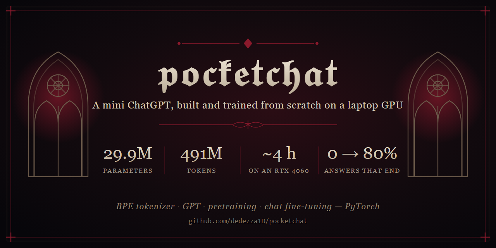

# pocketchat

<p align="center">
  
</p>

A small ChatGPT-style language model built and trained from scratch on a single laptop GPU (RTX 4060, 8 GB).

Everything is written by hand in Python and PyTorch: the byte-level BPE tokenizer, the transformer, the training loop and the chat format. No pretrained weights, no model libraries.

## Pipeline

1. **Corpus**: English educational web text streamed from [FineWeb-Edu](https://huggingface.co/datasets/HuggingFaceFW/fineweb-edu) (ODC-By).
2. **Tokenizer**: byte-level BPE trained on the corpus (`pocketchat/tokenizer.py`).
3. **Model**: decoder-only transformer with RoPE, RMSNorm, SwiGLU and tied embeddings (`pocketchat/model.py`).
4. **Pretraining**: next-token prediction with bf16, gradient accumulation and a cosine learning-rate schedule (`scripts/pretrain.py`), evaluated on fixed validation windows (`scripts/evaluate.py`).
5. **Chat fine-tuning**: supervised fine-tuning on `<|user|>` / `<|assistant|>` conversations, with the loss on assistant tokens only (`scripts/prepare_sft.py`, `scripts/sft.py`).
6. **Evaluation and chat**: a fixed question set measuring whether answers end, their length and their repetition (`scripts/eval_chat.py`); a terminal chat (`scripts/chat.py`).

## Results

| Stage | Model | Result |
|---|---|---|
| Pretraining | 29.9M parameters, 491M tokens, ~4 h | validation loss 3.243 (perplexity 25.6) on all 4,997 fixed windows |
| Chat fine-tuning | 17.4k conversations from [oasst1](https://huggingface.co/datasets/OpenAssistant/oasst1) (Apache-2.0) and [Dolly 15k](https://huggingface.co/datasets/databricks/databricks-dolly-15k) (CC BY-SA 3.0), ~20 min | assistant-token validation loss 2.574 |

Fixed set of 30 questions, same seed and sampling (temperature 0.7, top-p 0.9, repetition penalty 1.1):

| Model | Answers that end | Mean length | Repeated 3-grams |
|---|---|---|---|
| Pretrained only | 0% | 200 tokens (limit) | 66% |
| Fine-tuned, chat-token rows kept | 77% | 106 tokens | 9.3% |
| Fine-tuned, chat-token rows reinitialized | 80% | 99 tokens | 6.7% |

After pretraining, the `<|user|>`, `<|assistant|>` and `<|end|>` embedding rows had collapsed to nearly the same vector (cosine 0.996): through the tied output head they were the wrong answer at every step. Reinitializing them before fine-tuning was slightly better on every measure.

Fine-tuning teaches the format (answer, then stop); it does not add knowledge. At this size the answers are fluent and on topic but often wrong ("The sky blue is blue because of the color green."). Full answers are in `evals/`.

## Quick start

```bash
uv sync
uv run pytest
uv run python scripts/download_corpus.py --docs 5000 --out data/corpus_small.jsonl
uv run python scripts/train_tokenizer.py --corpus data/corpus_small.jsonl --docs 5000
uv run python scripts/tokenize_corpus.py --corpus data/corpus_small.jsonl
uv run python scripts/pretrain.py --max-steps 300 --out checkpoints/smoke.pt
uv run python scripts/sample.py --ckpt checkpoints/smoke.pt --prompt "The water cycle"
```

Full run (download, tokenizer, tokenization and pretraining, resumable):

```bash
uv run python scripts/run_full.py
```

Chat fine-tuning and evaluation:

```bash
uv run python scripts/prepare_sft.py
uv run python scripts/sft.py --out checkpoints/sft_reinit.pt --reinit-chat-tokens
uv run python scripts/eval_chat.py --ckpt checkpoints/sft_reinit.pt --name sft_reinit
uv run python scripts/chat.py --ckpt checkpoints/sft_reinit.pt
```

## License

The code is released under the [MIT License](LICENSE). The datasets keep their own licenses, listed below.

## Data licenses

FineWeb-Edu is released under ODC-By. oasst1 is Apache-2.0. databricks-dolly-15k is CC BY-SA 3.0 (attribution: Databricks). No outputs of commercial models were used for training.
