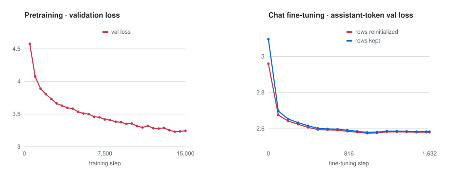

# pocketchat

[](https://github.com/dedezza1D/pocketchat/actions/workflows/tests.yml)

<p align="center">
  
</p>

A small ChatGPT-style language model built and trained from scratch on a single laptop GPU (RTX 4060, 8 GB).

Everything is written by hand in Python and PyTorch: the byte-level BPE tokenizer, the transformer, the training loop and the chat format. No pretrained weights, no model libraries.

I explain how it works, step by step and with every number measured on this model, in the series **Inside a ChatGPT**: [on the web](https://dedezza1d.github.io/inside-a-chatgpt/) and as a [LinkedIn newsletter](https://www.linkedin.com/newsletters/inside-a-chatgpt-7528472821451268096/).

## Try it

These steps download the published models, reproduce the numbers from the series and open a chat with the model. They need [git](https://git-scm.com/downloads) and [uv](https://docs.astral.sh/uv/getting-started/installation/); no GitHub account and no GPU. The commands are the same in a Linux or macOS terminal and in Windows PowerShell.

```bash
git clone https://github.com/dedezza1D/pocketchat.git
cd pocketchat
uv sync
uv run python scripts/download_weights.py all
```

`uv sync` installs Python packages, PyTorch included, into `.venv` (about 4.5 GB on Windows and Linux, which get the CUDA build). The two models are 120 MB each.

The chance of each next word, as in the tables of the series:

```bash
uv run python scripts/next_word.py --prompt "Water is made of hydrogen and" --word table
uv run python scripts/next_word.py --prompt "Water is made of hydrogen and" --temperature 0.5
uv run python scripts/next_word.py --ckpt checkpoints/sft_reinit.pt --prompt "Water is made of hydrogen and"
```

The first gives oxygen 52.9% and table 0.00011% (Part 0), the second oxygen 96.4% (Part 1), and the third oxygen 28.8% after chat fine-tuning (Part 2). Special tokens can be written in the prompt: `--prompt "<|user|>What is water made of?<|end|><|assistant|>Water is made of hydrogen and oxygen." --word "<|end|>"` gives 21.9% with the chat model.

A chat in the terminal (`/reset` starts over, `/quit` leaves):

```bash
uv run python scripts/chat.py
```

Each run draws different answers; on a CPU, each takes a few seconds. With `--seed`, the same conversation gets the same answers on the same machine. The answers quoted in Part 2 are in `evals/sft_reinit.md`; they were drawn with seed 1337 on an RTX 4060, so `--seed 1337` gives them again for a first question on that GPU ("Why is the sky blue?" → "The sky blue is blue because of the color green."). On a CPU or another GPU, the sampling and the bf16 arithmetic differ, and the same seed gives other answers.

## Pipeline

1. **Corpus**: English educational web text streamed from [FineWeb-Edu](https://huggingface.co/datasets/HuggingFaceFW/fineweb-edu) (ODC-By).
2. **Tokenizer**: byte-level BPE trained on the corpus (`pocketchat/tokenizer.py`).
3. **Model**: decoder-only transformer with RoPE, RMSNorm, SwiGLU and tied embeddings (`pocketchat/model.py`).
4. **Pretraining**: next-token prediction with bf16, gradient accumulation and a cosine learning-rate schedule (`scripts/pretrain.py`), evaluated on fixed validation windows (`scripts/evaluate.py`).
5. **Chat fine-tuning**: supervised fine-tuning on `<|user|>` / `<|assistant|>` conversations, with the loss on assistant tokens only (`scripts/prepare_sft.py`, `scripts/sft.py`).
6. **Evaluation and chat**: a fixed question set measuring whether answers end, their length and their repetition (`scripts/eval_chat.py`); a terminal chat (`scripts/chat.py`).

Every checkpoint records the tokenizer it was trained with (path and SHA-256), and loading refuses a tokenizer that does not match (`pocketchat/checkpoint.py`).

## Model and training

| | |
|---|---|
| Architecture | 8 layers, 8 heads, width 512, SwiGLU hidden 1,408, context 512, vocabulary 8,192, tied embeddings |
| Parameters | 29.9M |
| Pretraining | 15,000 steps × 32,768 tokens (491M token positions sampled from a 483M-token corpus), AdamW (β 0.9, 0.95), weight decay 0.1, learning rate 1e-3 → 1e-4 (warmup + cosine), bf16, peak 3.2 GiB, about 4 h |
| Fine-tuning | 17,411 conversations, 3 passes (1,632 steps), learning rate 1e-4 → 1e-5, about 20 min |

<p align="center">
  
</p>

(`scripts/plot_curves.py`. During pretraining each point used a sampled subset of the validation windows; on all 4,997 windows, the final loss is 3.243.)

## Results

| Stage | Result |
|---|---|
| Pretraining | validation loss 3.243 (perplexity 25.6) on all 4,997 fixed windows |
| Chat fine-tuning on [oasst1](https://huggingface.co/datasets/OpenAssistant/oasst1) (Apache-2.0) and [Dolly 15k](https://huggingface.co/datasets/databricks/databricks-dolly-15k) (CC BY-SA 3.0) | assistant-token validation loss 2.574 (lowest of 17 evaluations; 2.580 at the last step) |

A fixed set of 30 questions, one sample per question with the same seed and sampling (temperature 0.7, top-p 0.9, repetition penalty 1.1, at most 200 tokens):

| Model | Answers that end | Mean length | Repeated 3-grams |
|---|---|---|---|
| Pretrained only | 0% | 200 tokens (limit) | 66% |
| Fine-tuned, chat-token rows kept | 77% | 106 tokens | 9.3% |
| Fine-tuned, chat-token rows reinitialized | 80% | 99 tokens | 6.7% |

The pretrained model has never seen the chat tokens, so it cannot end an answer by construction; the 0% shows the format, not a weakness of the model. Full answers are in `evals/`.

Two answers from the fine-tuned model:

> **What is the capital of France?** Capital of France is the capital of France.
>
> **Why is the sky blue?** The sky blue is blue because of the color green.

Fine-tuning teaches the format (answer, then stop); it does not add knowledge. At this size the answers are fluent and on topic but often wrong.

### Are the answers right?

500 [SQuAD v1.1](https://huggingface.co/datasets/rajpurkar/squad) questions, greedy decoding, asked alone (closed book) and after the Wikipedia paragraph that holds the answer (open book). "Contains" counts answers that include the reference answer (`evals/qa_*.md`):

| Model | Closed book: exact / contains | Open book: exact / contains |
|---|---|---|
| Pretrained only | 0% / 0.4% | 0% / 3.4% |
| Fine-tuned, chat-token rows reinitialized | 0% / 0.6% | 0% / 17.8% |

Without the paragraph the model does not know the answers. With it, the fine-tuned model copies the right span about one time in six, always inside a full sentence, so exact match stays at 0%. 18 paragraphs are near copies of pretraining text (`evals/qa_overlap.txt`); on them the scores are no better.

## Findings

- **The "best" pretraining checkpoint was noise.** Validation during training used a different random sample of windows each time, and near the end consecutive values moved by a few hundredths. Measured on all fixed windows, the last step (3.2429) was better than the step marked as best (3.2514). Since then, validation uses fixed windows and fine-tuning starts from the last step (`pretrain_final.pt`).
- **The chat tokens collapsed during pretraining.** With tied embeddings, the rows of `<|user|>`, `<|assistant|>` and `<|end|>` were the wrong answer at every step and ended up almost identical (cosine 0.996) and with a larger norm than ordinary rows (1.83 vs 1.10). Reinitializing them lowers the starting fine-tuning loss (3.10 → 2.96); after fine-tuning the two runs are within noise (2.579 vs 2.574, one seed each, and one answer apart on the 30 questions).
- **Fine-tuning made the model forget.** Perplexity on the pretraining validation set rose from 25.6 to 30.1 after fine-tuning (`evals/forgetting.txt`), and the chance of " oxygen" after "Water is made of hydrogen and" fell from 52.9% to 28.8%.

## Limitations

- One seed per experiment and one sample per question: differences of a few points between the two fine-tuning runs are not meaningful.
- Four of the 30 evaluation questions also appear as prompts in the fine-tuning data ("Why is the sky blue?" 11 times; "What is the capital of France?", "What causes earthquakes?", "What is the Pythagorean theorem?" once or twice; `scripts/check_eval_overlap.py`, `evals/eval_overlap.txt`). None appears in the validation conversations. The model still answers them wrong.
- The tokenizer was trained on documents that also include the validation split.
- Training samples windows with replacement, so about a third of the corpus was never seen.
- Generation recomputes the whole context for every token (no KV cache).
- The same seed reproduces answers only on the same GPU and PyTorch version (bf16 sampling on CUDA).

## Weights

Both models can be used without training:

- **Pretrained** (step 15,000, before chat fine-tuning), MIT License: [v0.1.0](https://github.com/dedezza1D/pocketchat/releases/tag/v0.1.0).

  ```bash
  uv run python scripts/download_weights.py pretrained
  uv run python scripts/sample.py --prompt "Water is made of hydrogen and" --seed 0
  ```

- **Chat** (fine-tuned, chat-token rows reinitialized), [CC BY-SA 3.0](https://creativecommons.org/licenses/by-sa/3.0/) because of the Dolly 15k data: [v0.2.0](https://github.com/dedezza1D/pocketchat/releases/tag/v0.2.0).

  ```bash
  uv run python scripts/download_weights.py chat
  uv run python scripts/chat.py --ckpt checkpoints/sft_reinit.pt
  ```

`download_weights.py` takes the files from the release pages above, with no GitHub account, and checks their SHA-256. It writes the model to `checkpoints/` and the tokenizer both releases share to `data/tokenizer_full.json`, and keeps files that are already there.

## Quick start

Training a small model from scratch, after the clone and `uv sync` from [Try it](#try-it):

```bash
uv run pytest
uv run python scripts/download_corpus.py --docs 5000 --out data/corpus_small.jsonl
uv run python scripts/train_tokenizer.py --corpus data/corpus_small.jsonl --docs 5000
uv run python scripts/tokenize_corpus.py --corpus data/corpus_small.jsonl
uv run python scripts/pretrain.py --max-steps 300 --out checkpoints/smoke.pt
uv run python scripts/sample.py --ckpt checkpoints/smoke_final.pt --prompt "The water cycle" --seed 0
```

On an RTX 4060, the tests take about 1 minute, the download 45 seconds, the tokenizer and tokenization 45 seconds together, and pretraining about 7 minutes; the samples are recognizable English that does not make sense yet. The steps write about 0.6 GB: 36 MB of data, `smoke.pt` and `smoke_final.pt` (120 MB each, the best and the last step) and `smoke.last.pt` (360 MB, which also holds the optimizer state so that `--resume` can continue the run). The download prints a notice about unauthenticated requests to the Hugging Face Hub; no account is needed.

On a CPU, the 300 steps above take hours. A shorter run takes about 12 minutes on a 16-thread laptop CPU and already produces words, though not sentences:

```bash
uv run python scripts/pretrain.py --max-steps 200 --batch-size 4 --grad-accum 1 --out checkpoints/smoke.pt
```

Full run (download, tokenizer, tokenization and pretraining, resumable; writes `checkpoints/pretrain_final.pt`). On an RTX 4060 it takes about 4 hours of pretraining plus the download of 400,000 documents, and writes about 3 GB of data (`data/corpus.jsonl`, 1.9 GB; `data/full/train.bin`, 0.97 GB) and 0.6 GB of checkpoints. If `data/tokenizer_full.json` is already there, for example from `download_weights.py`, the run uses it instead of training a new tokenizer:

```bash
uv run python scripts/run_full.py
```

Chat fine-tuning and evaluation:

```bash
uv run python scripts/prepare_sft.py
uv run python scripts/sft.py --out checkpoints/sft_reinit.pt --reinit-chat-tokens
uv run python scripts/eval_chat.py --ckpt checkpoints/sft_reinit.pt --name sft_reinit
uv run python scripts/evaluate.py --ckpt checkpoints/pretrain_final.pt checkpoints/sft_reinit.pt
uv run python scripts/eval_qa.py --ckpt checkpoints/sft_reinit.pt --name qa_sft_reinit
uv run python scripts/chat.py --ckpt checkpoints/sft_reinit.pt
```

On Windows and Linux, `uv sync` installs the CUDA build of PyTorch, which also runs on machines without an NVIDIA GPU. On macOS (Apple Silicon), it installs the standard build from PyPI and everything runs on the CPU; PyTorch no longer publishes builds for Intel Macs. The CI runs the tests on Linux (CPU build) and macOS.

## License

The code is released under the [MIT License](LICENSE). The datasets keep their own licenses, listed below.

## Data licenses

FineWeb-Edu is released under ODC-By (attribution: Hugging Face). oasst1 is Apache-2.0 (attribution: OpenAssistant). databricks-dolly-15k is CC BY-SA 3.0 (attribution: Databricks). No outputs of commercial models were used for training. SQuAD v1.1 (CC BY-SA 4.0, attribution: Rajpurkar et al.) is used only for evaluation.

The pretrained weights were trained only on FineWeb-Edu and are released under the MIT License, like the code. The chat weights were also trained on databricks-dolly-15k, so they are released under CC BY-SA 3.0, and modified versions must keep that license.
